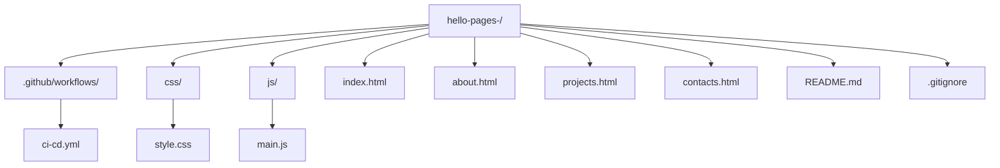

# hello-pages- Д Командный статический сайт с CI/CD

��чебный проект: статический сайт (HETML+CSS+JS) деплоится на **GHuB Pages** через **GitHub Actions**.

## 🌐 Живой сайт— **https://darryyaya.github.io/hello-pages-/**

## 📊 Deployments
“ **https://github.com/darryyaya/hello-pages-/deployments**

## 🌐 Environments
“ **https://github.com/darryyaya/hello-pages-/settings/environments**

## 👵 Команда

| Роль | GitHub | Вклад |
| --- | --- | --- |
| **Лидер1** | [darryyaya](https://github.com/darryyaya) | Репозиторий, README
| **DevOps** | [devops_user](https://github.com/devops_user) | workflow, Pages
| **Программист 1** | [xem1zo](https://github.com/xem1zo) | главная, styles

| **Программист 2** | [poluhindanil123-cpu](https://github.com/polyhindanil123-cpu) | проекты, JS
## 📂 Структура проекта



## 🎯 Страницы сайта
- 🏠 [Главная](https://darryyaya.github.io/hello-pages-/)
- 👥 [О нас](https://darryyaya.github.io/hello-pages-/about.html)
- 💼 [Проекты](https://darryyaya.github.io/hello-pages-/projects.html)
- ✉️ [Контакты](https://darryyaya.github.io/hello-pages-/contacts.html)

## 🛠 Технологии
- **HTML5**, **CSS3**, **JavaScript**
- **GitHub Actions** -- CI/CD
- **GitHub Pages** -- хостинг
- **GitHub Environments** -- `github-pages`
- **GitHub Deployments** -- история

## 🔄 CI/CD Pipeline

```mermaid
graph LR
    A[Push to main] --> B{Job: validate}
    B -->|HTML validen| 
