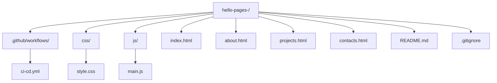
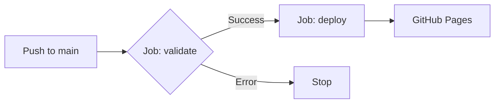

# hello-pages- — Командный статический сайт с CI/CD

Учебный проект: статический сайт (HTML+CSS+JS) с автоматическим деплоем на GitHub Pages через GitHub Actions.

## 🌐 Живой сайт
👉 https://darryyaya.github.io/hello-pages-/

## 📊 Deployments
👉 https://github.com/darryyaya/hello-pages-/deployments

## 🌍 Environments
👉 https://github.com/darryyaya/hello-pages-/settings/environments

## 👥 Команда

| Роль | GitHub | Вклад |
|---|---|---|
| Лидер | [darryyaya](https://github.com/darryyaya) | Репозиторий, README, About |
| DevOps | [devops_user](https://github.com/devops_user) | CI/CD workflow, Pages |
| Программист 1 | [xem1zo](https://github.com/xem1zo) | Главная, стили, About |
| Программист 2 | [poluhindanil123-cpu](https://github.com/poluhindanil123-cpu) | Проекты, Контакты, JS |

## 📂 Структура проекта



## 🎯 Страницы сайта
- 🏠 [Главная](https://darryyaya.github.io/hello-pages-/)
- 👥 [О нас](https://darryyaya.github.io/hello-pages-/about.html)
- 💼 [Проекты](https://darryyaya.github.io/hello-pages-/projects.html)
- ✉️ [Контакты](https://darryyaya.github.io/hello-pages-/contacts.html)

## 🛠 Технологии
- HTML5, CSS3, JavaScript
- GitHub Actions — CI/CD
- GitHub Pages — хостинг
- GitHub Environments — `github-pages`
- GitHub Deployments — история

## 🔄 CI/CD Pipeline



- CI: проверка файлов и валидности HTML
- CD: `needs: validate` → деплой после CI

## 🚀 Локальный запуск

```bash
python -m http.server 8000
```
Откройте http://localhost:8000

## 📝 Коммиты
Всего: 11 коммитов от 4 участников — равное участие.

---
© 2026 Команда hello-pages-
